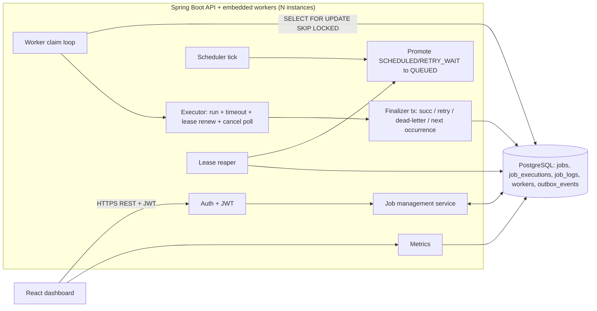
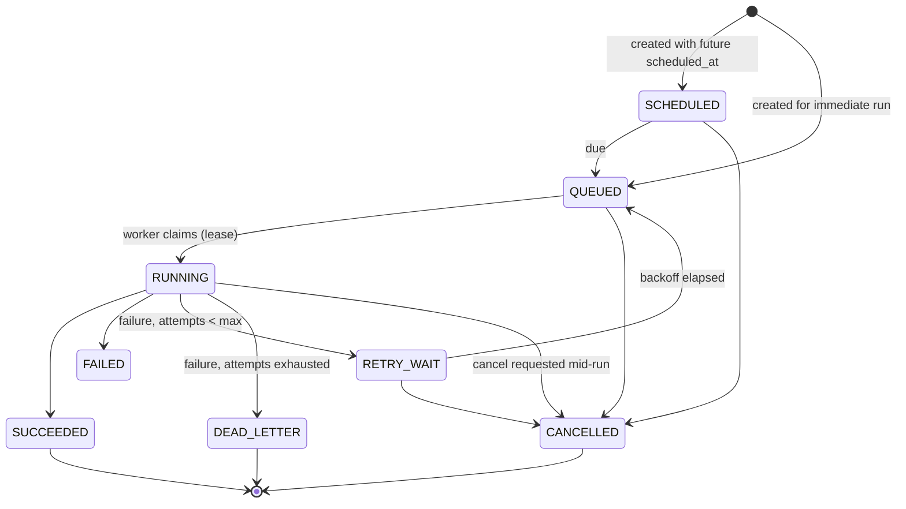
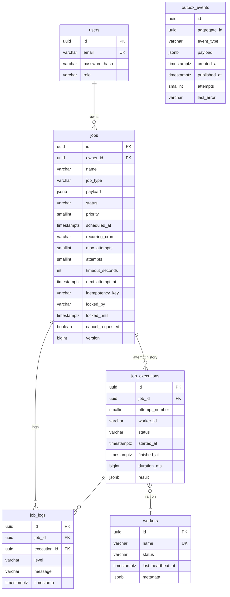

# TaskFlow Architecture

TaskFlow is a distributed job scheduling and execution platform. PostgreSQL is
the single source of truth for job state; workers coordinate purely through the
database, which makes scale-out safe without dedicated messaging broker.

## High-level data flow

## Modular layout

| Module | Responsibility |
|---|---|
| `auth` | JWT issuance/validation, Spring Security filter chain, registration/login |
| `user` | User accounts, roles (USER/ADMIN) |
| `job` | Job entities/state machine, CRUD + cancel, idempotency, DTOs, backoff policy |
| `engine` | Claim (FOR UPDATE SKIP LOCKED), execution, timeouts, lease heartbeat, cancellation, finalization |
| `engine.handler` | Safe built-in job types: ECHO, WAIT, HTTP_REQUEST, DEMO_FAILURE |
| `recovery` (`LeaseReaper`) | Promote due jobs, recover expired leases, mark stale workers |
| `worker` | Worker registration, heartbeats, health listing |
| `execution` | Per-attempt execution records and job logs |
| `metrics` | Dashboard aggregations (status counts, 24h success rate, hourly buckets) |
| `config` | OpenAPI, SPA serving, DATABASE_URL normalization |

Controllers speak DTOs only; JPA entities never cross the API boundary.

## Job lifecycle state machine

Transitions are validated in `JobStateService`; the durable state changes are
atomic conditional `UPDATE`s.

## Claiming, leases and recovery

Each worker instance runs a claim loop:

1. Short transaction: `SELECT id FROM jobs ... FOR UPDATE SKIP LOCKED LIMIT 1`,
   mark `RUNNING` with `locked_by` + `locked_until` (lease), increment
   `attempts`, create the `job_execution` record. Nothing else happens inside
   the lock; it is released at commit.
2. Handler execution runs **outside any transaction.** A supervision loop
   renews the lease every `heartbeat-seconds`, enforces `timeout_seconds`,
   polls `cancel_requested` every 2 s, and produces an in-memory outcome.
3. A second short transaction finalizes: `SUCCEEDED`, `RETRY_WAIT` with
   exponential backoff (15s · 2^n, capped at 3600s), `DEAD_LETTER` when the
   budget is exhausted, `CANCELLED`, or requeue for a recurring job's next
   cron occurrence.

If a worker dies mid-run, the lease expires silently. The **LeaseReaper** (per
instance, every few seconds) returns expired-lease jobs to `QUEUED` (or
`DEAD_LETTER` when the budget is spent) and closes the orphaned execution
record with `LEASE_EXPIRED`.

## Execution semantics: at-least-once

Database transactions cannot make external side effects exactly-once. TaskFlow
documents and implements **at-least-once delivery**: a job may run twice if a
worker crashes after its side effect but before reporting; handlers must be
idempotent and may use the `idempotency_key` to deduplicate downstream effects.

## Security

- Auth via email/password (BCrypt) and short-lived JWT (HS256).
- All `/api/**` endpoints require authentication; `/api/workers/**` is ADMIN-only.
- Job access is owner-scoped: users only see their own jobs (admins see all);
  existence is never leaked across owners.
- `HTTP_REQUEST` is SSRF-protected: http(s) only, host must resolve to a public
  address, credentials-in-URL blocked, low ports blocked, redirects disabled,
  hard timeouts, and error messages scrubbed of secrets.

## Database schema (ER)

Key indexes: `(status, priority DESC, next_attempt_at)` for claiming, partial
indexes for due SCHEDULED/RETRY_WAIT jobs and expired RUNNING leases,
`owner_id`/`status` for listing and filtering, and a partial unique
`(owner_id, idempotency_key)` to enforce idempotency scope. Attempt numbers
are unique per job via a table constraint.

`outbox_events` ships with migration v1 for the planned RabbitMQ dispatch
stage (outbox pattern); schemas stay forward-compatible.

## Planned evolution

The current dispatcher is database-first (SKIP LOCKED). The documented next
stage is: API writes an outbox event in the same transaction as the job change
→ outbox dispatcher publishes to RabbitMQ → external worker consumers claim
and report back through the same API contract. PostgreSQL remains the source
of truth in both stages.
